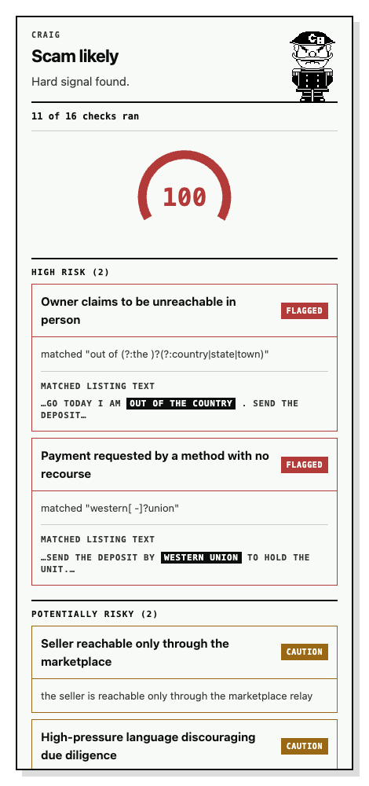
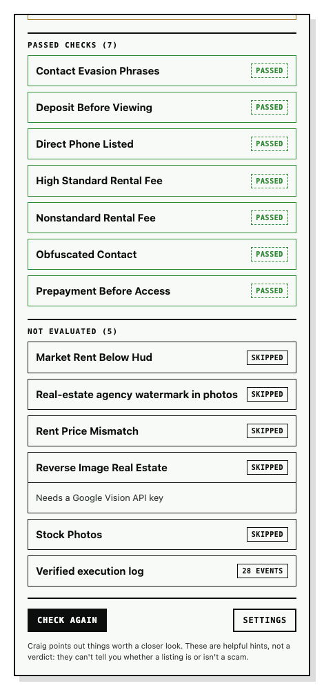

# Craig

Local-first, explainable scam indicators for Craigslist listings.

Craig is a Chrome extension that checks listing text, contact details, rental
fees, advertised rent, and optional photo evidence. The Go analysis engine runs
inside the extension as WebAssembly. Listing text stays in your browser, and
no account or local server is required.

**[Install from the Chrome Web Store](https://chromewebstore.google.com/detail/craig/hgpimmenacnoeochcfdogbmikinkjkhp)**

[Website](https://craig.aidandevaney.com/) ·
[Privacy policy](PRIVACY.md) · [Security](SECURITY.md) · [MIT license](LICENSE)

## Contents

- [Example analysis](#example-analysis)
- [Installation](#installation)
- [Usage and configuration](#usage-and-configuration)
- [Default checks and scoring](#default-checks-and-scoring)
- [Privacy and storage](#privacy-and-storage)
- [Command line and local daemon](#command-line-and-local-daemon)
- [Development](#development)
- [Repository layout](#repository-layout)
- [Releases](#releases)
- [Contributing and support](#contributing-and-support)
- [License](#license)

## Example analysis

The current result panel, using the fictional listing in the
[CLI example](#command-line-and-local-daemon) with no Vision key:

<p>
  
  
</p>

The first view shows the score and matched text. The second shows passed and
unavailable checks, including why a photo check could not run.

## Installation

### Chrome Web Store

1. Install [Craig](https://chromewebstore.google.com/detail/craig/hgpimmenacnoeochcfdogbmikinkjkhp) in Chrome 120 or later.
2. Open an individual Craigslist listing over HTTPS. Reload listings that were
   already open when you installed the extension.
3. Click the Craig toolbar icon to analyze the listing.

The current browser adapter supports Craigslist listing pages. The default
rules focus on rental listings; other marketplaces are not supported.

### Build from source

Prerequisites: Git, Make, Node.js 22 with npm, and Docker with a running Docker
engine. The Makefile uses a Go 1.25 container; a host Go installation is optional.
Run these commands from a POSIX shell:

```sh
git clone https://github.com/aidandevv/craig.git
cd craig
make extension-install
make wasm
make extension-build
```

Open `chrome://extensions`, enable **Developer mode**, choose **Load unpacked**,
and select the repository's `extension` directory. Follow the same usage steps
as the store version. After rebuilding, reload the extension and the listing tab.

`make wasm` generates both `extension/generated/engine.wasm` and the matching Go
runtime, `wasm_exec.js`. Both are required before building or testing the extension.

## Usage and configuration

Analysis runs on demand by default. Text and structured-data checks require no
credentials. Photo checks appear as **not evaluated** until a Google Cloud
Vision key is configured. Open the extension's **Options** to change settings.

### Optional photo checks

Follow the five setup steps under **Photo checks** in Options to create a Google
Cloud project, enable billing and the Cloud Vision API, and save an API key.
Restrict the key to the Cloud Vision API and configure a Google Cloud budget
alert. Google bills photo checks to your project.

| Setting                      | Default | Behavior                                                                       |
| ---------------------------- | ------- | ------------------------------------------------------------------------------ |
| Vision API key               | None    | Photo checks remain unavailable until a key is saved                           |
| Photos per listing           | 4       | Checks the first photos up to this limit; configurable from 1 to 24            |
| Monthly limit per check type | 999     | Separate counters for reverse-image and OCR checks                             |
| Analyze automatically        | Off     | When enabled, analyzes each listing when it opens and permits new photo checks |

With the default image rules, each uncached photo uses one `WEB_DETECTION`
request shared by the real-estate and stock-photo rules, plus one
`TEXT_DETECTION` request for watermark text. Only HTTPS photo URLs hosted on
`images.craigslist.org` are submitted.

- **Toolbar icon:** reruns analysis and requests fresh photo evidence, subject
  to the monthly limit.
- **Check again in the result panel:** reruns analysis with current rules and
  cached evidence. If auto-run is enabled, missing photo evidence may be fetched.
- **Auto-run:** reuses photo evidence for up to 24 hours and may fetch evidence
  on a cache miss.

With auto-run off, listing analysis can contact Vision only after a toolbar
click. The Options page's **Test key** action also contacts Google, using an
empty request. The result panel includes coverage and a collapsed **Verified
execution log** for the request; the log excludes credentials, listing text,
and image URLs. If Craig asks you to wait, allow at least 10 seconds between
analyses in the same tab.

### Rules

The Options rule builder can add, edit, disable, or remove curated pattern
rules, including their text scope, preset, and severity. Other rule types and
custom expressions are displayed as read-only cards and preserved when you save.
The engine validates the complete ruleset before applying it.

For custom YAML rules, start with
[`internal/rules/default_rules.yaml`](internal/rules/default_rules.yaml) and use
the [CLI](#command-line-and-local-daemon). The Options page does not provide a
YAML editor or controls for fee and rent thresholds. To change those defaults
in a source build, edit the embedded YAML and rebuild the WebAssembly engine
and extension.

## Default checks and scoring

Craig ships with 16 enabled rules:

| Category            | Checks                                                                                                                                                                                          |
| ------------------- | ----------------------------------------------------------------------------------------------------------------------------------------------------------------------------------------------- |
| Payment and contact | Irreversible payment requests, urgency, absent owners, contact evasion, deposits or payments before access, obfuscated contact details, marketplace-only contact, and direct phone availability |
| Rental fees         | Nonstandard hold, reservation, and similar fees; unusually high standard fees                                                                                                                   |
| Rent                | Advertised-price inconsistencies and unusually low rent against supported HUD benchmarks                                                                                                        |
| Photos, optional    | Matches on real-estate sites, stock-photo sources, and agency or MLS watermark text                                                                                                             |

Photo matching uses matching pages and full or partial image matches from
Vision; visually similar suggestions are ignored. Partial photo failures are
reported in coverage rather than treated as a clean result.

### Rental fees and rent comparisons

- **Fees:** nonstandard fees are caution signals regardless of amount. Standard
  fees are flagged above category-specific thresholds; the default application
  fee threshold is $50. These are review cues, not statements about local law.
  Fee rules cannot create a hard flag.
- **Advertised rent:** a dollar amount in the title that differs from the page
  price by at least 10% of the page price adds a caution signal. A missing page
  price or empty title makes the check unavailable. A title without a dollar
  amount produces no mismatch finding.
- **HUD benchmark:** monthly USD rents at or below 65% of the bundled benchmark
  add a caution signal with weight `0.15`. The check requires a bedroom count
  from studio through four bedrooms and a supported five-digit ZIP. Missing
  inputs or unsupported ZIPs are reported as **not evaluated**.

The bundled [HUD FY 2027 Small Area Fair Market Rent snapshot](internal/marketdata/fy2027_selected.json)
covers 1,395 ZIP codes across the SF Bay Area, Los Angeles, and the New York
metro area, including Jersey City and Newark. Its recorded effective date is
October 1, 2026. The
[source workbook](https://www.huduser.gov/portal/datasets/fmr/fmr2027/FY27_safmrs.xlsx)
provides ZIP-level 40th-percentile gross rents, including estimated tenant-paid
utilities. It is an offline comparison benchmark, not a live asking-rent feed
or property valuation. Craig does not geocode addresses or substitute citywide
rates for unsupported ZIPs.

### Interpreting results

Rule contributions are added and clamped to a score from `0` to `1`. The default
bands begin at `0.30` for caution, `0.55` for elevated concern, and `0.75` for high
concern. A hard flag sets the band to high without changing the arithmetic
score. Positive signals are informational and never reduce the score.

Every enabled rule is reported as high risk, potentially risky, a positive
signal, passed, or not evaluated. Coverage is shown separately, and the badge
uses a partial-check state when too few rules ran, unless a hard flag was found.
Craig's results are indicators for further verification; they do not prove
fraud or establish that a listing is safe.

## Privacy and storage

The Chrome extension analyzes listing text locally and does not persist listing
payloads or completed assessments. There are no accounts or analytics.

The extension stores the following in this browser profile's
`chrome.storage.local`, restricted to trusted extension contexts:

- The Vision API key, settings, and saved rules.
- Vision photo evidence, keyed by a hash of the image URL and check type.
  Evidence is reused for up to 24 hours; expired entries are pruned after analysis.
- Photo-check usage counters keyed by month and check type.

Optional photo checks send public photo URLs and your key to Google Cloud
Vision. The key is sent in a request header. Uninstalling the extension removes
its browser storage. See [PRIVACY.md](PRIVACY.md) and
[SECURITY.md](SECURITY.md) for the extension's data handling and trust boundaries.
The optional native daemon uses separate configuration files and SQLite storage.

## Command line and local daemon

The native `analyze` command uses the same rule, detector, and scoring packages
to check a JSON listing offline:

```sh
make build
./bin/craig-extension analyze --data '{
  "title": "Beautiful 2BR - MUST GO TODAY",
  "description": "I am out of the country. Send the deposit by western union to hold the unit.",
  "contact": {"relay_only": true}
}'
```

With the embedded rules, this example reports risk `1.00`, a high band, a hard
flag, and coverage of 11 of 16 checks. Runtime varies by machine.

| Flag                  | Purpose                                                  |
| --------------------- | -------------------------------------------------------- |
| `--data '<json>'`     | Read an inline listing                                   |
| `--file listing.json` | Read a listing file; use `--file -` for stdin            |
| `--rules rules.yaml`  | Load a custom YAML ruleset instead of the embedded rules |
| `--json`              | Emit the full assessment as JSON                         |

Pass exactly one of `--data` or `--file`. The `analyze` command does not load
Vision credentials or daemon configuration; image rules always report
`no_api_key`. See [`internal/domain/types.go`](internal/domain/types.go) for the
listing fields. Run `./bin/craig-extension analyze -h` for command help.

An optional native daemon provides an authenticated HTTP API, bound to
`127.0.0.1:8765` by default:

```sh
./bin/craig-extension config init
./bin/craig-extension daemon
```

Initialization creates private config and rules files under
`~/.config/craig-extension/`; the daemon uses a SQLite cache under
`~/.local/share/craig-extension/`. It can run Vision checks when credentials are
configured. Run `./bin/craig-extension daemon -h` for flags. The current Chrome
extension runs independently and does not connect to this daemon.

## Development

After the [source setup](#build-from-source), run:

```sh
make test             # Go vet, tests, and native build in Docker
make extension-test   # DOM fixtures, badge, worker, storage, and WASM integration tests
make extension-build  # TypeScript checks and extension bundles
```

Re-run `make wasm` after changing Go code or embedded rules. Additional targets:

| Command                              | Purpose                                              |
| ------------------------------------ | ---------------------------------------------------- |
| `make build`                         | Build the host-platform CLI at `bin/craig-extension` |
| `make format`                        | Format Go sources with `gofmt` in Docker             |
| `make tidy`                          | Update Go module metadata in Docker                  |
| `make test-pkg PKG=./internal/rules` | Run one Go package's tests in Docker                 |

CI runs Go vet, race tests, the native build, and a Go vulnerability scan. It
also builds and tests the extension and verifies that the shared WebAssembly
engine does not depend on native-only storage or daemon packages. See
[`.github/workflows/ci.yml`](.github/workflows/ci.yml) for the exact checks.

### Mascot assets

[`mascot-motion/`](mascot-motion/README.md) is a separate Remotion project for
sprites and animation assets. It is not required to build or use the extension.
It has its own dependency install, tests, linting, and export commands; see its
README for setup.

### Refreshing HUD data

The source workbook is not committed. Regenerating the current FY 2027 snapshot
requires Python 3.11 or later and `openpyxl` in your Python environment:

```sh
python3 scripts/build_hud_safmr_data.py FY27_safmrs.xlsx \
  internal/marketdata/fy2027_selected.json
```

The generator is specific to FY 2027. When moving to a new schedule, update its
source metadata, the embedded asset reference and validation in
[`internal/marketdata/hud_safmr.go`](internal/marketdata/hud_safmr.go), and related
tests and documentation. Rebuild the WebAssembly engine to include changed data.

## Repository layout

| Path                                                                                                                 | Purpose                                                                           |
| -------------------------------------------------------------------------------------------------------------------- | --------------------------------------------------------------------------------- |
| [`extension/`](extension/)                                                                                           | Manifest V3 worker, Craigslist adapter, results panel, Options, and browser tests |
| [`cmd/craig-wasm/`](cmd/craig-wasm/)                                                                                 | WebAssembly entry point and extension-storage bridge                              |
| [`cmd/craig-extension/`](cmd/craig-extension/)                                                                       | Offline CLI, native configuration, and optional daemon                            |
| [`internal/engine/`](internal/engine/), [`internal/browserapi/`](internal/browserapi/)                               | Analysis pipeline for the browser and daemon, plus the browser JSON API           |
| [`internal/domain/`](internal/domain/), [`internal/marketplace/`](internal/marketplace/)                             | Shared listing and result types; payload normalization and validation             |
| [`internal/rules/`](internal/rules/), [`internal/detect/`](internal/detect/), [`internal/risk/`](internal/risk/)     | Rule parsing and compilation, concurrent detectors, scoring, and coverage         |
| [`internal/signals/`](internal/signals/), [`internal/marketdata/`](internal/marketdata/)                             | Vision photo checks and embedded HUD rent benchmarks                              |
| [`internal/cache/`](internal/cache/), [`internal/config/`](internal/config/), [`internal/daemon/`](internal/daemon/) | Native-only SQLite storage, private configuration, and HTTP API                   |
| [`internal/trace/`](internal/trace/)                                                                                 | Request execution tracing                                                         |
| [`scripts/`](scripts/)                                                                                               | HUD snapshot generator                                                            |
| [`mascot-motion/`](mascot-motion/README.md)                                                                          | Mascot source artwork, animation compositions, and asset exporters                |

## Releases

The [web release workflow](.github/workflows/release-web.yml) runs on `web-v*`
tags. The version suffix must match `extension/manifest.json`, and the tagged
commit must be reachable from `main`. CI builds the engine, tests and builds
the extension, then creates a draft GitHub release with
`craig-web-package.zip`. The archive contains `manifest.json`, `assets/`, and
`dist/` for manual Chrome Web Store upload; the workflow does not publish to
the store.

## Contributing and support

Use a focused working branch and run the relevant development checks before
opening a pull request. Changes to detection rules should include examples of
both suspicious phrasing and ordinary listing text to guard against false
positives. Adapter changes should update the DOM fixtures and extraction tests.

For bugs and feature requests, use this repository's GitHub Issues. Include the
extension and Chrome versions, sanitized reproduction steps, and relevant
execution-log details. Report vulnerabilities privately as described in
[SECURITY.md](SECURITY.md).

## License

This repository is licensed under the [MIT License](LICENSE). Third-party
dependencies retain their respective licenses.
